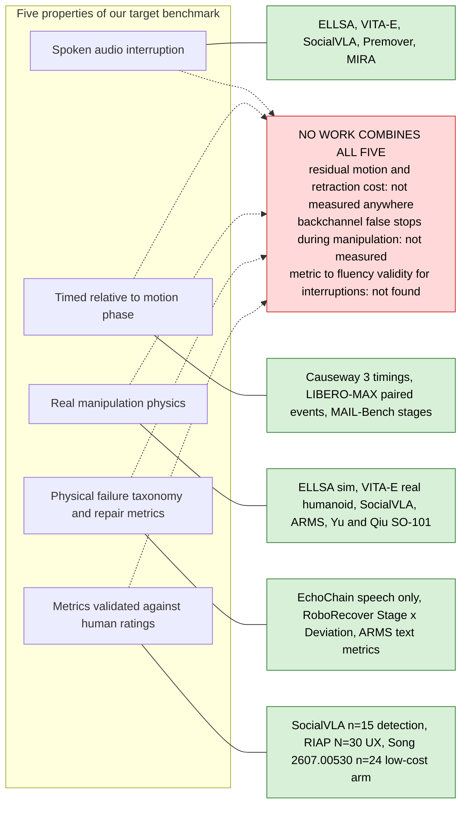
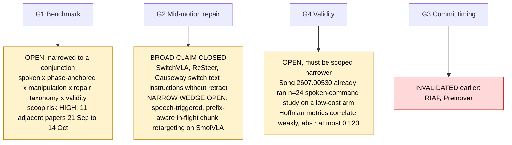
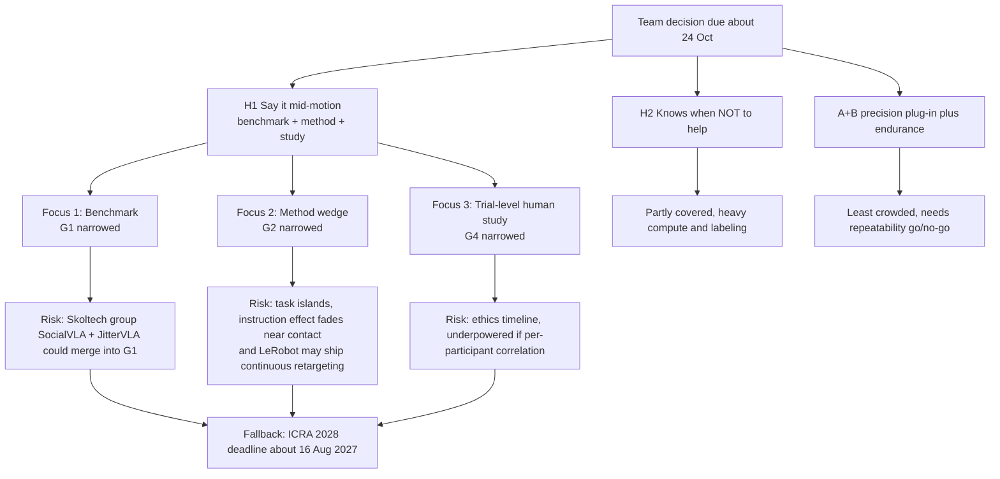
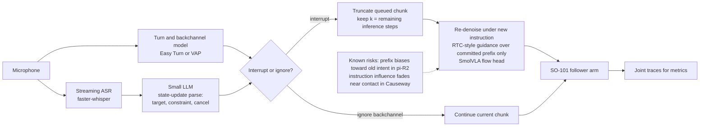
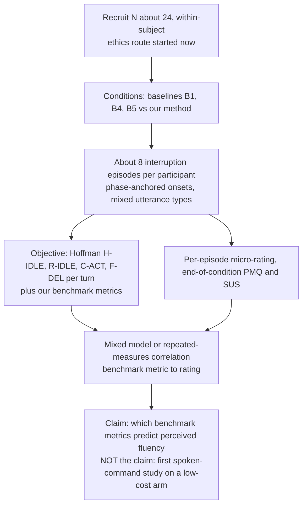
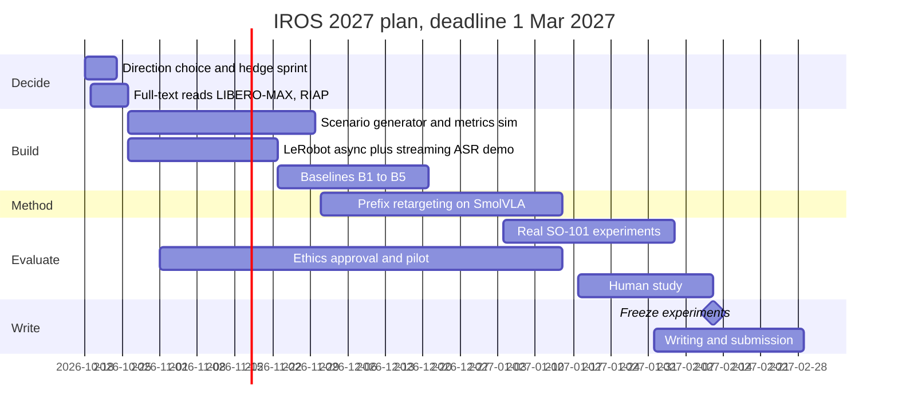

# Research map: what is covered, what is missing, where to focus, how to build it

Written 2026-10-18 after Feynman passes G1, G2, G4, strategy comparison, and SocialVLA/Causeway full-text summaries (all in `outputs/`). Diagrams are **synthesis** of those reports; the evidence and [V]/[S]/[U] flags live in the reports, not here. View diagrams with VS Code's Markdown Preview (Mermaid support) or on GitHub.

Sources for each claim: G1 = `outputs/g1-interruption-benchmark-novelty.md`, G2 = `outputs/g2-midmotion-repair-novelty.md` (partial delivery, verified), G4 = `outputs/g4-fluency-metrics-validity.md` (partial, fixes not applied), CMP = `outputs/midmotion-instruction-handling-strategies.md` (partial, unverified), SV = `outputs/socialvla-summary.md`, CW = `outputs/causeway-summary.md`.

---
## 1. What is covered vs missing (the five G1 properties)

Each of the five properties already exists somewhere; no single work has all five (G1 §2). Green = precedented, red = nobody found.



## 2. Gap status after this pass (what changed)



## 3. Where research can focus: options and recommendation

Recommendation (inference): **one paper = G1 benchmark as the spine, G2 narrow wedge as the method, G4 trial-level study as validation.** If scooped on the benchmark, the study-heavy variant moves to ICRA 2028. A+B stays the hardware hedge.



---
## 4. Implementation structure per focus

### Focus 1 — Benchmark (G1). Build first; sim-first, then real SO-101.

Design borrowed from Causeway (timing grid, success relative to solo, Reach and Finish-given-Reach, same/cross-object strata) and SocialVLA (hold criterion, latency decomposition). Added by us: audio overlap, non-permanent interruption types, motion-quality metrics, human validation.

```mermaid
flowchart LR
  subgraph GEN["Scenario generator"]
    T["Task pairs A to B<br/>same-object and cross-object strata"]
    O["Onset scheduler<br/>by STATE not step count:<br/>approach, grasp, transport, place<br/>hand-object distance, gripper state"]
    U["Utterance bank<br/>target change, constraint, speed or manner,<br/>cancel, backchannel, self-correction"]
  end
  subgraph AUD["Audio"]
    TTS["Voice-cloned TTS users"]
    HUM["Real human speakers"]
  end
  subgraph RUN["Execution under test"]
    POL["Policy: SmolVLA, ACT<br/>LeRobot async stack"]
    HND["Interruption handler under test<br/>B1 to B6 baselines, our method"]
    ENV["MuJoCo or Isaac sim, then real SO-101"]
  end
  subgraph MET["Metrics"]
    M1["Switch success relative to solo task rate"]
    M2["Reach, Finish given Reach"]
    M3["Residual motion after onset, retraction distance"]
    M4["Onset to motion-change latency, jerk discontinuity"]
    M5["False barge-in rate on backchannel and off-target speech"]
  end
  CTRL["Controls: bare text switch, state-placement reference<br/>separates speech failure from task-island failure"]
  T --> O --> U --> TTS --> POL
  U --> HUM --> POL
  POL --> HND --> ENV --> MET
  CTRL -.-> MET
  MET --> TAX["Failure taxonomy labels<br/>inertia, amnesia, displacement,<br/>spurious halt, wrong-object commit"]
```



Planned repo layout (proposal; nothing built yet):

```
benchmark/
  scenarios/      # task pairs, onset rules, utterance bank (YAML)
  audio/          # TTS render + human recording protocol
  harness/        # runs policy + handler, logs joint traces + audio timestamps
  metrics/        # residual motion, retraction, jerk, latency, false-barge-in
  taxonomy/       # label rules + annotator guide
  sim/            # MuJoCo / Isaac scenes (pick-place with 2 objects, 2 bowls)
```

### Focus 2 — Method wedge (G2). Narrow: speech-triggered, prefix-aware in-flight retargeting on SmolVLA.

All four properties must hold together to be novel (G2 §5): speech overlaps motion, no hold or retract, in-flight chunk repair with a latency-bounded committed prefix, low-cost SmolVLA stack, plus physical-continuity evaluation.



Baselines to implement (G2 §6): B1 hold-and-refresh (LeRobot `set_task`, exists), B2 bare switch, B3 truncate + fresh chunk without RTC, B4 retract-to-home (VITA-E style), B5 step-boundary wait (Hi Robot/CIRRA style), B6 ReSteer-style switch-data fine-tune. Optional: B7 Causeway write (high effort, SmolVLA only), B8 ACT checkpoint switch.
Ablation: committed-prefix `keep` in {0, 1x, 2x turnaround}.
Constraint: ACT has no language input, so instruction-triggered repair applies to SmolVLA; ACT only serves as a motion-quality or blending baseline.

### Focus 3 — Trial-level human study (G4)

Per-participant correlation is underpowered at n=18 to 39 (r near 0.12 would need about 543). Use many episodes per participant (G4 §1 item 6: N=24, 8 trials each, within-r 0.3 gives simulated power 0.98).



---
## 5. Timeline to 1 March 2027 (proposal, dates from `02-iros-2027-constraints.md`)



## 6. Open items this pass created
- Read full texts: LIBERO-MAX (verify where the paired protocol originates), RIAP (physics and speech?), ARMS (spoken?), Song et al. 2607.00530.
- G2, G4 and the comparison are now complete (see iteration 7). Pending: rewrite of `06-paper-story.md` per `outputs/paper-story-review.md`; RTC-vs-LeRobot `/audit` not run.
- Blocked, user action: NeurIPS 2026 RTCA workshop accepted list (OpenReview JS page); ELLSA GitHub; RIAP full text.
- Verify claim in G2 that LeRobot `set_task` is stop-based by running it ourselves on SO-101 (supervisor present, boundaries rule 1).
