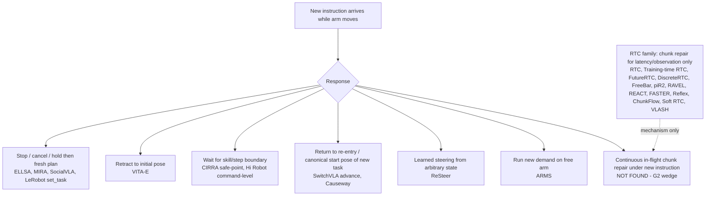

# G2 novelty re-check: mid-motion repair without stop-and-retract

**Date:** 2026-10-18 · **Scope:** Has anyone published a method that updates/repairs an *in-flight* action chunk of a VLA/ACT/flow/diffusion policy in response to a *new language or speech instruction while the arm is moving*? · **Status flags:** [V] verified from primary text/code read this session; [S] secondary only; [U] unverified/inference.

## 1. Bottom line

1. **The broad G2 claim ("mid-motion repair after an instruction change, without stop-and-retract") is no longer open.** Learned or training-free *text*-instruction switching from intermediate states, without returning home, is now published: SwitchVLA (2506.03574; learned forward/rollback/advance, dual Franka) [V], ReSteer (2603.17300; stage-aware switch-data generation + self-refining BC, π0.5 on DROID/Franka, steering success 33%→73% real) [V via alphaXiv report], and Causeway (2609.30913; training-free representation write, π0.5 on xArm 6, pooled real switch success 42.9→100 / 14.3→94.3 / 17.1→82.9 at approach / pre-grasp / after-A) [V].
2. **The RTC family (RTC and ≥12 2026 descendants) repairs chunks only for latency/observation staleness; none treats a changed instruction as a trigger, and none uses speech** [V for all 10 papers read in research-A plus RTC, πR², FutureRTC, DiscreteRTC]. Reflex explicitly pins the instruction in a static KV prefix "computed once" [V]; RAVEL holds "the same … language instructions" fixed [V].
3. **Speech-triggered systems still stop, cancel, hold or retract**: ELLSA ("Action Cancelled" + stop, LIBERO sim) [V], VITA-E (preempt + retract to initial pose via inverse action stack; authors list smoother transitions as future work) [V], MIRA (VAD barge-in → abort, 466 ms speech-start→abort) [V], SocialVLA (hold; "remains paused until the participant explicitly requests continuation") [V]. Hi Robot re-plans at the command level after Whisper ASR; in-flight chunk handling is not described [V/U].
4. **LeRobot itself already ships a runtime instruction-change path, and it is explicitly stop-based.** On `main` (commit 146d847, 2026-10-16) `set_task()` exists on every inference engine; `docs/source/inference.mdx` L419: "…invalidates queued/interpolated motion, waits for the control loop to acknowledge the hold, then requests fresh motion under the new task. **Expect a stop during this transition; it is not a guaranteed continuous blend.**" The README design table lists "Immediate planned language wait — discards continuation and can disrupt task progress" [V, lead re-checked by grep]. This is our ready-made stop-and-replan baseline *and* a sign that HF may close the gap at the infrastructure level.
5. **Narrowest surviving wedge (see §5):** *speech-overlap-triggered, prefix-aware in-flight retargeting* — truncate the queued chunk to a latency-bounded committed prefix and re-denoise under the new (possibly still-streaming) instruction with RTC-style guidance only over that prefix, on SmolVLA/SO-101, evaluated with physical continuity metrics against LeRobot's hold-and-refresh, retract, boundary-wait and bare-switch baselines. No source found combines all of: (a) overlapping/streaming speech trigger, (b) no hold/retract, (c) in-flight chunk repair via prefix conditioning, (d) low-cost arm with SmolVLA/ACT [inference from §2–3; research-C sweep of 17 queries found none].

**Scoop risk: high and rising.** At least 8 directly adjacent papers appeared between 2026-09-01 and 2026-10-15 (Causeway, ARMS, CIRRA, MIRA, SocialVLA, RoboPrompt, EarlyCommit, REACT).

## 2. Taxonomy of what published systems do when the instruction changes mid-motion

Every node except I is supported by the primary-text extractions in §3 [V]; node I is the absence finding.

## 3. Evidence tables

### 3a. RTC and descendants (repair mechanism; trigger is never a new instruction)

| Paper (arXiv, date) | What is repaired / mechanism | Trigger | Real / sim | Base policy (SmolVLA/ACT?) | Code | Instr. change? | Speech? |
|---|---|---|---|---|---|---|---|
| RTC, Black et al. (2506.07339, 2025-06; NeurIPS 2025) | Next chunk generated during execution; first *d* actions frozen, overlap soft-masked, rest inpainted via ΠGDM guidance; inference-time only [V] | Observation / delay | Kinetix sim (12 tasks) + real bimanual, 6 tasks, 480 episodes [V] | π0.5 [V] | Sim code github.com/Physical-Intelligence/real-time-chunking-kinetix [V] | No [V] | No |
| Training-time RTC (2512.05964, 2025-12) | Prefix conditioning learned at train time (hard prefix only) [V] | Observation + committed prefix | Real (π0.6 box building, espresso) + Kinetix [V] | π0.6 [V] | Not stated | No | No |
| DiscreteRTC (2604.25050, 2026-04) | Discrete-diffusion unmasking natively inpaints committed prefix; early exit; ~0.7× compute [V] | Observation | Kinetix + real UR5e (dynamic pick/place, hockey) [V] | Qwen2.5-VL-3B + discrete diffusion head [V] | Website (URL not extracted) [U] | No | No |
| Soft RTC / Action-Prior Denoising (2605.25537, 2026-05) | Soft-editable overlap tokens; previous chunk as prior [V] | Prev. chunk + observation | Kinetix + preliminary real sorting (LeRobot/OpenPI runtime) [V] | Kinetix flow ckpts; real model not named [U] | Not stated | No (single fixed prompt) [V] | No |
| FASTER (2603.19199, 2026-03) | Horizon-aware per-action schedule; near-term actions in one step [V] | Environmental change | Real AgileX/Piper + LIBERO/CALVIN/Kinetix [V] | π0.5, X-VLA [V] | github.com/innovator-zero/FASTER [S] | No [V] | No |
| ChunkFlow (2607.12992, 2026-07) | Frozen/editable/future zones + blending + continuity losses [V] | Observation + history | CALVIN/LIBERO + real 6-DoF arm [V] | Backbone unclear [U] | Project page 404 [V] | No [V] | No |
| Reflex (2607.14695, 2026-07; ICML 2026) | Streaming inference, partitioned KV cache; instruction "permanently pinned" [V] | New frames | Sim only (LIBERO, Kinetix) [V] | π0.5, π0, **SmolVLA** (App. D.7, 2.29× speedup) [V] | github.com/9yc/Reflex [V] | Explicitly static [V] | No |
| FutureRTC (2607.24008, 2026-07) | Adapter predicts execution-time visual latent + corrected state; policy frozen [V] | Observation/state staleness | Kinetix + LIBERO + real (Hang Cups) [V] | π0.5, **SmolVLA-450M** (LeRobot LIBERO weights; RTC baseline 69.7% at d=5, ours 75.8%) [V] | Project website [U] | No | No |
| πR² (2607.26055, 2026-07) | Diffusion-forcing; in-flight actions as inpainting condition; fast proprio / slow VLM channel [V] | Proprioception (fast), vision-language (slow, async) | Sim + real xArm6+XHand [V] | GR00T-N1.7 [V] | pi-r2-flow.github.io [V] (code status [U]) | No | No |
| VLASH (2512.01031, 2025-11; v2 2026-07) | Future-state roll-forward conditioning [V] | State | Kinetix/LIBERO + real **SO-101** & Galaxea R1 Lite [V] | π0.5, GR00T N1.6 real; **SmolVLA** in LIBERO [V] | github.com/mit-han-lab/vlash [V] | No | No |
| RAVEL (2609.34170, 2026-09) | Rolling buffer of partially denoised actions; async VLM context [V] | Observation (+async VLM context incl. instruction) | LIBERO/RoboTwin + real xArm 7 [V] | π0.5, X-VLA [V] | Not stated | No; instructions held fixed [V] | No |
| Reactive RT Flow / RFD + Propose–Resolve (2609.36540, 2026-09) | K candidate continuations, resolved at handoff by latest obs [V] | Observation | Sim only (RoboMimic, LIBERO) [V] | **SmolVLA** (all experiments) [V] | Not stated | No [V] | No |
| REACT (2610.12007, 2026-10; CoRL 2026) | Rolling denoising: future blocks refined across recent observations [V] | Observation | RoboTwin + real ARX X5, Franka R3 [V] | π0.5 only [V] | react-vla.github.io (no code link) [V] | No [V] | No |
| FreeBar / Barrier-Constrained Guidance (2610.14997, 2026-10; CoRL 2026) | Closed-form CBF-style constraint aligning new chunk to committed stream [V] | Observation | Kinetix/RoboCasa + real humanoid & Franka [V] | GR00T, π0, π0.5 [V] | github.com/NamelessCrew/FreeBar [V] | No [V] | No |
| DREAM-Chunk (2606.18589, 2026-06) | Within-chunk switching among N sampled candidate chunks by latent-WM match [V] | Observation vs dreamed latent | Kinetix + real **SO-101** (3 tasks) + Franka [V] | **SmolVLA on SO-101** (USB 75→95%, moving object 60→80%) [V] | Project page [V] | No; candidates share instruction [V] | No |

Relevant mechanism observation [V, πR²]: RTC "struggles to recover from failures because previously generated in-flight actions bias the policy toward continuing its recent motion." For G2 this is the central technical tension: prefix conditioning that buys continuity also biases toward the *old* intent.

### 3b. Instruction/task switching and interruption systems

| Paper (arXiv, date) | Physical response to new instruction | Trigger | Real / sim | Base policy (SmolVLA/ACT?) | Code | Speech-overlap repair? |
|---|---|---|---|---|---|---|
| SwitchVLA (2506.03574, 2025-06) | Learned forward / rollback / **advance**; advance interpolates in joint space toward the new task's canonical start pose; effective at next chunk [V] | Text, any timestep (early/mid/late) [V] | LIBERO-Goal + real dual Franka [V] | Florence-2 + flow expert; **MT-ACT baseline scores 0.0 on mid-switch** (real WS1) [V] | Not released [V] | No (text, partial retract) |
| Hi Robot (2502.19417, 2025-02; ICML 2025) | High-level VLM re-triggered immediately on interjection; low-level π0 gets new command; chunk handling not described [V/U] | Speech via Whisper large-v2 → text [V] | Real UR5e, ARX, mobile ARX [V] | π0 [V] | Not stated [V] | No |
| VITA-E (2510.21817, 2025-10) | Standby model preempts active model; **retract to initial pose** via inverse action stack [V] | Speech (VITA-1.5 voice model) [V]; ASR vs end-to-end not explicit [U] | Real Fourier GR2 humanoid [V] | VITA-1.5 + GR00T DiT; SmolVLA only as manipulation baseline [V] | github.com/Tencent/VITA/tree/VITA-E [V link] | No — this *is* the retract baseline |
| ELLSA (2510.16756, 2025-10; ICLR 2026) | "Action Cancelled" + stop [V] | Spoken interruptive command [V] | LIBERO sim only [V] | Emu3 + FAST (autoregressive) [V] | github.com/bytedance/SALMONN/tree/ELLSA (from paper text [V]; repo page previously robots-blocked) | No — stop baseline |
| ReSteer (2603.17300, 2026-03) | Policy fine-tuned with stage-matched synthetic switch trajectories + SRBC to follow a new instruction from arbitrary states [V report] | Text prompt switch at any state | LIBERO-Goal + real DROID Franka [V report] | π0.5 [V report] | "commitment to release" [S] | No (text; no RTC/speech) |
| Causeway (2609.30913, 2026-09) | Training-free gradient write in action-stream representation; frozen VLA decodes a return motion to a task-B re-entry pose; can re-route a held bowl "without put-down or re-grasp" [V] | Text at approach / pre-grasp / post-completion [V] | LIBERO + real xArm 6 [V] | π0.5, OpenVLA-OFT, GR00T N1.5; per-chunk latency 2.5–2.8× [V] | Not stated [V] | No (text; re-entry, not in-chunk blend) |
| One Word, Different Action (2609.05260, 2026-09) | Offline LLM decision benchmark on real-robot anchors; no execution [V] | Text | Offline [V] | LLMs only [V] | Not stated | No |
| ARMS / Watch, Recall, Act (2609.28429, 2026-09; CoRL 2026) | New demand runs concurrently on a free arm; hard-interrupt ablation worse (FG continuation 76→41) [V] | Language + visual guards; speech not shown [U] | Real AgileX dual-arm [V] | π0.5 [V] | "will release" [V] | No (different strategy) |
| MIRA (2609.24547, 2026-09) | Barge-in → abort/"safe physical halting" of gestures [V] | Streaming speech, VAD gate 450 ms [V] | Real Astribot S1 [V] | Own diffusion gesture model (not manipulation) [V] | Project page [V] | No — stop |
| SocialVLA (2610.02360, 2026-10) | Hold (336 ms gate-to-hold), then participant-directed continuation/revision for "a subsequent VLA action" [V] | Vocal/paralinguistic + Vosk speech [V] | Real Unitree G1, 15 participants [V] | GR00T [V] | Not found [U] | No — stop-first |
| CIRRA (2610.08862, 2026-10) | Interruptibility modes: immediate pause / safe-point / uninterruptible; skill to standby [V] | Text [V] | CHIRP text benchmark + real Unitree G1 [V] | Qwen3-VL planner + ImageWAM skills [V] | URL not stated [V] | No — boundary wait |
| TempoBridge (2610.09451, 2026-10) | Tempo parsed once per instruction; phase-routed speed scaling [V] | Text (planned) | LIBERO + real xArm6 [V] | π0.5 [V] | Not stated | No |
| CorrectVLA (2608.29967, 2026-08) | Language correction after full rollout, reused across rollouts [V] | Text, offline | LIBERO-90 + real xArm7 [V] | OpenVLA-OFT, π0.5 [V] | Not stated | No |
| RoboPrompt (2610.10534, 2026-10) | Sparse sketch/point/direction prompts blended across replanning chunks via biased denoising [V] | Drawn/visual + coarse text direction [V] | Real Flexiv Rizon4 [V] | DP, π0.5, FastWAM [V] | github.com/yanwen-zou/Roboprompt [V link] | Partial mechanism; no speech/task switch |
| Flow Control (2606.10180, 2026-06) | User keyboard input injected into flow ODE initial condition; "change of mind" via ODE perturbation [V report] | Keyboard | Real Franka (DROID), 16-user study [V report] | π0.5-DROID [V report] | Not checked [U] | No (not language) |
| Premover (2605.12160, 2026-05; v2 2026-10) | Acts on streaming speech prefix; waits when ambiguous; no in-flight correction [V] | Streaming ASR prefix [V] | Real **SO-101** + LIBERO/VLA-Arena [V] | Frozen π0.5 (SmolVLA only cited) [V] | No URL found [V] | No (initial instruction only) |

Additional mechanism-level neighbours (abstract-level, [V] abstract unless noted): ReEnvision 2610.17977 (selective repair inside cached chunk, feedback-driven), CMAP 2610.14864 (span regeneration), Atomic Motion Coordinate 2609.15012 (force-triggered suffix regeneration), React When You Need To 2609.22587 (vision-event-triggered blend), VLA-Feedback 2609.21022 (final denoising step as feedback interface), ActionSplice 2609.08230 (prefix-preserving suffix correction in video world models), VLA-Corrector 2607.01804 ([S]; visual truncate-and-replan, evaluated on SmolVLA; ID not API-confirmed [U]), EarlyCommit 2610.20531 (word-by-word commitment; "no physical robot ... a commit is never revised"), ELLSA 2 2610.21452 (gestures only).

### 3c. LeRobot infrastructure (code read, [V])

| Item | Finding (main @146d847, 2026-10-16) |
|---|---|
| Async stack | Legacy `src/lerobot/async_inference/` (PolicyServer/RobotClient, `chunk_size_threshold=0.5`, `aggregate_fn` weighted average 0.3/0.7) last in **v0.6.1** (2026-08-03); retired on main, replaced by `lerobot.inference` (sync/rtc) and `lerobot.remote_inference` (Zenoh `lerobot-policy-server`, `lerobot-rollout --inference.type=remote`) |
| Task at runtime | v0.6.1: fixed at client start (`control_loop(task=cfg.task)`). main: `set_task()` + monotonic `task_version`; CLI `/subtask <text>`; `RolloutController.set_task()`; stale-version results rejected |
| Semantics of mid-request change | Hold → `queue.clear()` → fresh chunk without RTC prefix; "Expect a stop … not a guaranteed continuous blend" (inference.mdx L419); robots without hold "can exhaust remaining actions and terminate" |
| RTC | `src/lerobot/policies/rtc/`: guided (Jacobian/ΠGDM-style) for Pi0, Pi0.5, **SmolVLA**; `trained` mode Pi0.5 only; `execution_horizon` clamped to leftover length |
| ACT | No language input; no RTC; temporal ensembling only in sync `select_action` with `n_action_steps=1`; rejected by chunk runner |
| Paper numbers | SmolVLA/LeRobot async vs sync on SO-100: avg completion 9.70 s vs 13.75 s; 19 vs 9 cubes in 60 s; success 73.3% vs 78.3% avg (sorting 50 vs 70) [V, 2506.01844 / 2602.22818] |

## 4. Which works run on our policies

| Policy | Papers using it as base policy |
|---|---|
| **SmolVLA** | DREAM-Chunk (real SO-101) [V]; FutureRTC (LIBERO sim) [V]; Reactive RT Flow 2609.36540 (sim only) [V]; Reflex (sim, appendix) [V]; VLASH (LIBERO sim only; real SO-101 runs used π0.5/GR00T) [V]; LeRobot guided RTC (code) [V]; VLA-Corrector [S]; SO-101 benchmark 2606.08881 [V abstract]. VITA-E uses SmolVLA only as a manipulation baseline [V]. |
| **ACT** | No mid-motion repair or switching paper uses ACT as its method's base policy. MT-ACT appears as a SwitchVLA baseline (0.0 mid-switch success) [V]; ACT in SO-101 benchmark 2606.08881 [V abstract]. ACT in LeRobot has no language input [V code], so instruction-triggered repair with ACT reduces to checkpoint switching + blending. |
| **SO-101 hardware** | Premover (π0.5), VLASH (π0.5/GR00T), DREAM-Chunk (SmolVLA), 2606.08881 benchmark [V]. |

## 5. Is G2 still open? Narrowest surviving wedge

**Not in its original form.** "Mid-motion repair without stop-and-retract" is claimed by SwitchVLA (learned, 2025), ReSteer (learned, 2026-03) and Causeway (training-free, 2026-09) for *text* instruction switches; the honest differentiator is no longer "without retract" alone.

**Surviving wedge (all four needed together):**
1. **Trigger = speech that overlaps motion**, including partial/streaming utterances and self-corrections (none of SwitchVLA/ReSteer/Causeway uses speech; speech systems all stop/retract) [inference from §3b].
2. **Repair = in-flight chunk retargeting with a latency-bounded committed prefix** (truncate queue to *keep* ≈ remaining-inference steps, re-denoise with RTC guidance over only that prefix under the new instruction) — no hold, no return to a re-entry/start pose. This is distinct from Causeway (re-entry pose via representation write) and SwitchVLA (advance toward canonical start pose), and from all RTC descendants (fixed instruction) [inference].
3. **Low-cost stack**: SmolVLA on SO-101 via LeRobot; directly comparable to LeRobot's shipped stop-based `set_task` path [V code].
4. **Physical-continuity evaluation**: switch-onset→motion-change latency, jerk/velocity discontinuity, retraction distance, post-repair success — none of the switching papers reports a smoothness metric [V research-B synthesis].

**Key risks to the wedge:**
- *Steerability deficit*: ReSteer and Causeway both show instruction influence on actions attenuates near contact/grasp ("task islands", ‖Δa‖ drops 1–2 orders of magnitude before contact [V Causeway]). Prefix-aware RTC retargeting alone may fail near contact; we likely need ReSteer-style switch data on SO-101 (cite as prior art, not novelty).
- *RTC prefix bias toward old intent* [V πR²] — the core technical risk; must be measured, not assumed.
- *Infrastructure scoop*: LeRobot already has `set_task` and lists continuity work ("Buffered motion during informational VQA") as a potential extension [V README]; HF could ship continuous retargeting before March 2027.
- *Gains may be small vs hold-and-refresh* when SmolVLA latency (~99 ms on RTX 4090 [V]) is short relative to motion.

## 6. Baselines we must implement

| # | Baseline | Source of behaviour | Effort |
|---|---|---|---|
| B1 | **Hold-and-refresh** (stop-and-replan): LeRobot `set_task` / `/subtask` on main | LeRobot inference.mdx [V] | Free (exists) |
| B2 | **Bare switch**: change task between requests, keep queued old-task actions (no hold) | LeRobot between-request path [V]; "bare switch" in Causeway/ReSteer [V] | Trivial |
| B3 | **Truncate + fresh chunk, no RTC** (naive async) | RTC paper naive-async baseline [V] | Small |
| B4 | **Retract-to-home then restart** | VITA-E [V] | Small (record & reverse action stack) |
| B5 | **Step/skill-boundary wait** | Hi Robot / CIRRA safe-point [V] | Small (needs phase signal) |
| B6 | **Steering-data fine-tune** (ReSteer-style stage-matched switch demos) — as baseline *and* ablation of our method | ReSteer [V report] | Medium (data + fine-tune SmolVLA) |
| B7 (optional) | Causeway-style re-entry write | Causeway; code not stated [V] | High; reimplementation, needs per-arch calibration |
| B8 (ACT track) | ACT checkpoint switch + LeRobot aligned blending | LeRobot code [V] | Small; only if ACT is kept |

SwitchVLA code is not released [V], so it can only be cited or approximated via B6.

## 7. Open questions / next steps

- Does Premover v2 (2026-10-05) handle a contradicting later word mid-execution? Appendix not fully read [U].
- ReSteer code/data release status [S]; πR², FutureRTC, DiscreteRTC code status [U].
- ARMS: are interruptions spoken? [U]. VITA-E: ASR vs end-to-end audio? [U].
- Not searched: OpenReview/CoRL-2026 camera-readies not on arXiv, Chinese-language preprints, industry demos (PI, Figure) of verbal mid-motion corrections.
- **Minimal experiment (planned, not run):** on SO-101 + SmolVLA, issue a target-change utterance at approach / pre-grasp / in-transport; compare B1–B3 vs RTC-retarget with *keep* ∈ {0, 1×, 2× turnaround}; measure switch success and jerk. `TODO: run experiment`.
- Re-run this sweep weekly until submission (1 Mar 2027).

## Blocked sources

- None blocked by robots.txt, paywall or login in this run. Previously recorded: ELLSA GitHub page (ROBOTS_DISALLOWED) — not re-fetched; repo URL taken from paper text only.
- Not blocked but unavailable: ChunkFlow project page (404), FASTER project page (404); FASTER PDF >20 MB (HTML used).

## Sources

- RTC — https://arxiv.org/abs/2506.07339
- Training-Time RTC — https://arxiv.org/abs/2512.05964
- DiscreteRTC — https://arxiv.org/abs/2604.25050
- Action-Prior Denoising (Soft RTC) — https://arxiv.org/abs/2605.25537
- FASTER — https://arxiv.org/abs/2603.19199
- ChunkFlow — https://arxiv.org/abs/2607.12992
- Reflex — https://arxiv.org/abs/2607.14695
- FutureRTC — https://arxiv.org/abs/2607.24008
- πR² — https://arxiv.org/abs/2607.26055
- VLASH — https://arxiv.org/abs/2512.01031
- RAVEL — https://arxiv.org/abs/2609.34170
- Reactive Real-Time Flow Policies — https://arxiv.org/abs/2609.36540
- REACT — https://arxiv.org/abs/2610.12007
- FreeBar — https://arxiv.org/abs/2610.14997
- DREAM-Chunk — https://arxiv.org/abs/2606.18589
- SwitchVLA — https://arxiv.org/abs/2506.03574
- Hi Robot — https://arxiv.org/abs/2502.19417
- VITA-E — https://arxiv.org/abs/2510.21817
- ELLSA — https://arxiv.org/abs/2510.16756
- ELLSA 2 — https://arxiv.org/abs/2610.21452
- ReSteer — https://arxiv.org/abs/2603.17300
- Causeway — https://arxiv.org/abs/2609.30913
- One Word, Different Action — https://arxiv.org/abs/2609.05260
- Watch, Recall, Act (ARMS) — https://arxiv.org/abs/2609.28429
- MIRA — https://arxiv.org/abs/2609.24547
- SocialVLA — https://arxiv.org/abs/2610.02360
- CIRRA — https://arxiv.org/abs/2610.08862
- TempoBridge — https://arxiv.org/abs/2610.09451
- CorrectVLA — https://arxiv.org/abs/2608.29967
- RoboPrompt — https://arxiv.org/abs/2610.10534
- Flow Control — https://arxiv.org/abs/2606.10180
- Premover — https://arxiv.org/abs/2605.12160
- EarlyCommit — https://arxiv.org/abs/2610.20531
- ReEnvision — https://arxiv.org/abs/2610.17977
- CMAP — https://arxiv.org/abs/2610.14864
- Atomic Motion Coordinate — https://arxiv.org/abs/2609.15012
- React When You Need To — https://arxiv.org/abs/2609.22587
- VLA-Feedback (Catch Me If You Can) — https://arxiv.org/abs/2609.21022
- ActionSplice — https://arxiv.org/abs/2609.08230
- VLA-Corrector — https://www.alphaxiv.org/abs/2607.01804 [U ID]
- SO-101 VLA benchmark — https://arxiv.org/abs/2606.08881
- SmolVLA — https://arxiv.org/abs/2506.01844
- LeRobot paper — https://arxiv.org/abs/2602.22818
- LeRobot code (main) — https://github.com/huggingface/lerobot (docs/source/inference.mdx, docs/source/remote_inference.mdx, docs/source/rtc.mdx, src/lerobot/inference/rtc.py, src/lerobot/remote_inference/README.md)
- LeRobot v0.6.1 async_inference — https://github.com/huggingface/lerobot/tree/v0.6.1/src/lerobot/async_inference
