> **Status: COMPLETE (2026-10-18).** Draft verified and revised in a resumed session: 13/13 arXiv IDs and 12/12 cited non-arXiv URLs resolve to the named sources (the one URL cited as 404 is confirmed 404); 11 high-stakes cells re-checked against primary text; 0 FATAL / 3 MAJOR / 9 MINOR findings, all fixed. See `outputs/.drafts/midmotion-instruction-handling-strategies-verification.md` and `midmotion-instruction-handling-strategies.provenance.md`. Remaining unverifiable items are listed under Blocked sources / Open.

# Source comparison: what existing systems do when an instruction arrives while the arm is moving

Date: 2026-10-18 · Slug: `midmotion-instruction-handling-strategies` · Scope: 12 systems named in the request, plus ACT (2304.13705) and SmolVLA (2506.01844) as the target backbones.
Flags: **[V]** verified from primary full text / abstract / official repo in this pass (by the lead or a researcher pass whose notes are in `outputs/.drafts/midmotion-instruction-handling-strategies-R{1,2,3}.md`); **[S]** secondary only; **[U]** unverified or our inference. Numbers are quoted as the sources state them; none were reproduced.
Verification: all 13 arXiv IDs and 12 cited non-arXiv URLs checked to resolve to the named source (github.com/VITA-MLLM/VITA-E confirmed 404, as cited); LeRobot code files fetched via raw.githubusercontent.com; 11 high-stakes cells re-checked against primary text (details and fixes: `outputs/.drafts/midmotion-instruction-handling-strategies-verification.md`). Cells still resting only on researcher notes are listed under Blocked/Open.
Builds on: `outputs/g1-interruption-benchmark-novelty.md` (G1 novelty check) and `outputs/.drafts/g2-midmotion-repair-novelty-research-A.md` (RTC descendants).

## 1. Summary

- **No system repairs an in-flight manipulation trajectory in response to overlapping *speech* while preserving progress.** The ones with live speech on a real manipulator either stop/hold (SocialVLA), retract home (VITA-E), or re-prompt a low-level policy through a hierarchy without measuring motion continuity (Hi Robot). The ones that switch smoothly mid-contact (SwitchVLA, Causeway) are text-only [U — synthesis over the 12 compared systems, not an exhaustive search; per-system facts are [V] in §3].
- **Four physical answers exist** to "what happens at the moment of interruption": (1) *halt first* — ELLSA, SocialVLA, MIRA, LeRobot-main planned hold (only when an inference request is in flight); (2) *undo then switch* — VITA-E retraction, SwitchVLA rollback; (3) *redirect without stopping* — SwitchVLA advance, Causeway steered re-entry, Hi Robot re-prompt, RTC/async chunk replacement; (4) *move before the instruction ends* — Premover, EarlyCommit, RIAP. Groups 1–3 react to a new instruction; group 4 does not handle a change of mind once moving (Premover and EarlyCommit say so explicitly; RIAP claims partial revision handling at abstract level only) [V per system; the four-way grouping is our synthesis].
- **Hi Robot does not wait for the atomic step boundary according to its own paper.** "When the system receives a user intervention, the high-level inference is triggered immediately" (2502.19417 §4.2) [V]; independently, the high level re-runs "when one second has elapsed, or when a new interaction with the user takes place" (§4.1) [V]. The "waits for the step to finish" characterisation comes from VITA-E's and SwitchVLA's related-work sections [S]. Physically, the new atomic command only reaches the arm at the low-level policy's next chunk inference; the paper describes no stop or retract [U].
- **Latency numbers are not comparable across papers**: they stop at different endpoints (abort command dispatched, physical hold, per-chunk compute, voice response, per-word classification). Among the compared systems, only SocialVLA reports latency to a *physical* hold (gate→hold 336 ms median, n=24; reaction onset→hold 1.021 s median, n=14) [V].
- **For SO-101 with SmolVLA/ACT on 8 GB**, the directly reusable pieces are policy-agnostic wrappers: LeRobot-main task versioning + planned hold + guided RTC for SmolVLA (already in the codebase), a SocialVLA/MIRA-style VAD/keyword hold gate, MIRA's bounded commitment (cap the executed chunk prefix), VITA-E's chunk LIFO retraction stack, and EarlyCommit's 421M text gate. SwitchVLA's recipe (contact + behaviour-mode conditioning, reversed-demo rollback labels) is the most promising *learned* method to port, but needs retraining and has no code [V for components; U for portability].
- **ACT is the weak point**: it has no language input, LeRobot remote inference runs it with temporal ensembling disabled, RTC does not apply (not flow/diffusion), and in SwitchVLA's real-robot table MT-ACT switches at 0.0% (early) / 0.0% (mid) / 4.9% (late) on Workstation 1 [V].

## 2. Taxonomy of strategies (Mermaid)

Node labels say *who decides* ([learned in policy] vs [wrapper/orchestrator]) and the trigger modality. Structure is source-supported per §3; grouping is our synthesis.

```mermaid
flowchart TD
  R["New instruction arrives while arm moves"] --> A["Anticipate: act before utterance ends"]
  R --> H["Halt first"]
  R --> U["Undo, then switch"]
  R --> D["Redirect without stopping"]

  A --> A1["Premover: readiness gate + shared-prefix consensus on streaming ASR prefix<br/>[heads on frozen VLA] TTS speech, real SO-101"]
  A --> A2["EarlyCommit: calibrated word-by-word object commit, never revised<br/>[wrapper, 421M text classifier] speech→ASR, no robot"]
  A --> A3["RIAP: ACT / WAIT / DEFER from intent confidence vs safety cost<br/>[wrapper?] partial speech, sim replays (abstract only)"]

  H --> H1["ELLSA: say 'Action Cancelled' and stop<br/>[learned, end-to-end audio] TTS, LIBERO sim"]
  H --> H2["SocialVLA: reaction-triggered pause, human resumes/revises<br/>[wrapper, policy-agnostic] live paralinguistic + stop phrases, real G1"]
  H --> H3["MIRA: VAD gate aborts after bounded 0.5 s prefix; LLM arbiter IGNORE / REPLY / INTERRUPT_AND_REPLY<br/>[wrapper] live speech, gestures only"]
  H --> H4["LeRobot main (RTC/remote): task version bump; planned hold only if inference in flight, then fresh replan<br/>[wrapper] typed text"]

  U --> U1["VITA-E: [HALT] preempt, retract to initial pose via inverse action stack, start new task<br/>[dual VLM controller] live speech, real GR2"]
  U --> U2["SwitchVLA rollback: reverse actions while in contact<br/>[learned in policy] text, real Franka"]

  D --> D1["SwitchVLA advance: interpolate to new task start when not in contact<br/>[learned in policy] text"]
  D --> D2["Causeway: gradient 'write' steers frozen VLA to re-entry pose, then handoff<br/>[inference-time, backbone-specific] text, real xArm"]
  D --> D3["Hi Robot: high-level VLM re-runs immediately, new atomic command to pi0<br/>[hierarchy] text or Whisper ASR, real UR5e/ARX"]
  D --> D4["RTC / legacy LeRobot async: freeze committed prefix, inpaint or blend next chunk<br/>[execution layer] observation-driven; instruction change not evaluated"]
  D --> D5["LeRobot main: no inference pending → accepted old-task actions keep executing until a new-task chunk replaces the queue; sync engine drops queue and re-infers<br/>[wrapper] typed text"]
```

## 3. Dimension matrix

### 3a. Behaviour at interruption

| System (ID) | Trigger modality → model input | Physically at the moment of interruption | Repair / continuation | Latency as stated (endpoint) |
|---|---|---|---|---|
| **ELLSA** (2510.16756) | TTS speech (CosyVoice2), 10 fixed stop phrases, end-to-end audio via streaming Mamba encoder; no ASR at inference [V] | Stops; model outputs "Action Cancelled". Speech injected 2–8 s after instruction, random [V]. Stop effective at 1 s block granularity [U] | None after stop. Non-stop questions answered while acting [V] | 786 ms speech→action, 854 ms speech→speech per 1 s block (A100); 428/455 ms with 0.48 s blocks [V] |
| **VITA-E** (2510.21817) | Live speech → VITA-1.5 audio encoder (end-to-end) + Silero VAD in demo [V code] | `[HALT]`: Standby model preempts Active model, final halt sent. Switch: preempt → "returns the robot to the initial pose by sequentially popping and executing inverse movements from a stored action stack" [V] | New task started from home; old task not resumed. Authors list smoother transitions as future work [V] | 2.26 s average voice-response latency (10 tests); no halt-to-stop latency; GPU not stated [V] |
| **Hi Robot** (2502.19417) | Text or live speech → Whisper large-v2 → text [V] | High-level VLM "triggered immediately" to recompute atomic command; also re-runs every 1 s regardless [V]; low-level π0 keeps executing until it receives it [U]. No stop/retract described [V] | Corrective atomic commands + optional verbal reply; user can signal return to previous command. No memory [V] | Low-level 73 ms on-board / 86 ms off-board + WiFi per step; high-level 47 ms prefill + 13.2 ms decode per step (RTX 4090). ASR latency not reported [V] |
| **SwitchVLA** (2506.03574) | Text instruction (BART), paired with previous instruction + contact state; no speech [V] | Policy predicts behaviour mode each step: forward / rollback ("undoes previous actions … while in contact") / advance ("transitions to a new subtask when … no physical interaction") [V] | Learned: rollback = reversed demo actions; advance = joint-space interpolation to canonical start pose of new task [V] | Not reported; 15 Hz control on RTX 4090 [V] |
| **Causeway** (2609.30913) | Text instruction ℓB swapped in at approach / pre-grasp / post-completion [V] | Switch immediately; if holding the wrong object only the gripper channel is steered until it opens, else position+orientation engage [V] | Gradient "write" through frozen decoder toward demo-derived re-entry pose; engagement → return → dwell → handoff to frozen VLA [V] | Per-chunk 102/75/128 → 253/187/362 ms (OFT/π0.5/GR00T) on A100-80GB during re-entry; +≤4.3 GiB [V] |
| **Premover** (2605.12160) | TTS speech (XTTS-v2) → faster-whisper streaming ASR → text prefix to frozen VLA [V] | Starts moving before the instruction ends; executes only actions shared across candidate completions ("consensus-guided execution") [V] | Replans each chunk as prefix grows. "We do not consider corrections or changes … after execution has begun" [V] | Heads add 0.232 ms over 65.84 ms forward; SO-101 wall-clock 60.5 → 49.7 s (−17.9%) [V] |
| **RIAP** (NeurIPS 2026 poster 162424) | Partial speech (abstract) [V-abstract] | Chooses ACT / WAIT / DEFER from intent confidence vs safety cost [V-abstract] | "corrected for 60.6% of mid-utterance human revisions" [V-abstract]; mechanism unknown [U] | "anticipated user commands by an average of 1,022 ms" [V-abstract] |
| **EarlyCommit** (2610.20531) | Speech → faster-whisper small.en → words → text classifier [V] | Commits to an object at first word with calibrated p ≥ τ, then caller's controller reaches; "A commit is final" [V] | None; asks "which one" if no commit by last word [V] | 31–35 ms/word median, 38–41 ms p95 (RTX 3060 laptop / T4); saves 0.79–1.06 s per instruction [V] |
| **SocialVLA** (2610.02360) | Live human reactions: paralinguistic audio (wav2vec2 + ExtraTrees), face/video, Vosk stop phrases; first-event fusion [V] | One pause command → VLA held; "remains paused until the participant explicitly requests continuation" [V] | Human resumes, restarts, or revises instruction; correction transcript logged with active chunk for curation; no retraining [V] | Gate→physical hold 336 ms median (p95 681 ms, n=24); reaction onset→hold 1.021 s median (p95 1.569 s, n=14); detector→fusion 0.048 s median (n=22) [V] |
| **MIRA** (2609.24547) | Live speech: Silero VAD fast gate + streaming ASR → LLM arbiter [V] | On 450 ms sustained speech: abort response, stop TTS, terminate motion after committed 0.50 s (15-frame) prefix [V] | Arbiter: IGNORE → continue interrupted response from saved context; INTERRUPT_AND_REPLY → new response [V] | speech_started → abort_cmd_sent 466 ms (P50); not to physical stop [V] |
| **RTC** (2506.07339) | Observation (async loop); instruction change not studied [V] | Keeps moving: first d actions frozen, new chunk swapped in "as soon as it is available" [V] | ΠGDM inpainting with exponentially decaying soft mask toward previous chunk [V]. For a new instruction, overlap is pulled toward the *old* plan [U] | Model 76 ms vanilla / 97 ms RTC (RTX 4090); Fig. 1 claims operation under inference delays >300 ms; no degradation at +100/+200 ms injected latency [V] |
| **LeRobot async** (repo; SmolVLA 2506.01844) | v0.4.0: `--task` fixed per run [V]. Main: typed `/subtask <text>` → `set_task`, versioned [V] | v0.4.0: no mid-run change [V]. Main: sync engine drops queued actions and re-infers [V]; RTC/remote with inference in flight → **planned hold** (retain last driver target), old-task result discarded [V]; RTC/remote with *no* inference pending → already-accepted old-task actions "retain continuity" (keep executing) until a new-task prediction replaces the future queue [V code: `remote_inference/engine.py`, `inference/rtc.py` `set_task`] | Fresh prediction from post-hold observation; merged by alignment/blend/RTC [V]. README reports "Fresh replanning can lose task progress, as observed on hardware" for VQA/language waits [V]; retargets use the same planned-wait + fresh-resumption path, so progress loss on instruction change is plausible but not reported [U] | Hold/retarget latency not measured [V]. SmolVLA paper: async 9.7 s vs sync 13.75 s task time on SO100 [V] |

### 3b. Implementation and reuse

| System | Backbone / size | Real vs sim | Human study | Code / weights | GPU fit (8 GB / 48 GB) | Applicable to SmolVLA / ACT on SO-101? |
|---|---|---|---|---|---|---|
| ELLSA | Llama-3.1-8B speech expert + Emu3-Base (UniVLA) action expert, FAST tokens; HF weights ~36.6 GB [V] | Sim only (LIBERO, CALVIN variant) [V] | None [V] | HF weights + eval code; training "coming soon"; GitHub blocked [V] | 8 GB no; 48 GB borderline [U] | Not transplantable (behaviour learned inside 16B-class model). Stop-phrase list and per-tick stop token idea reusable [U] |
| VITA-E | VITA-1.5 (Qwen2, ~7B [U]) + GR00T-N1 DiT head, horizon 16; two instances (Active/Standby) [V] | Real Fourier GR2 humanoid + LIBERO [V] | None (human raters in ablation only) [V] | Code at Tencent/VITA branch VITA-E; HF weights VITA-MLLM/VITA-E; github.com/VITA-MLLM/VITA-E 404 [V] | README: "A total of 48 GB GPU memory is needed" — stated for the web demo with mocked robot state [V]; 8 GB no | Retraction stack + preemption control flow is backbone-agnostic and can wrap SmolVLA/ACT chunks [U] |
| Hi Robot | 2 × PaliGemma-3B (π0 low level + VLM high level) [V] | Real UR5e, bimanual ARX, mobile ARX [V] | No user study; blind evaluator scores IA/TP, 20 trials/task/method [V] | No code linked [V] | Paper: 1–2 × RTX 4090 [V]; 8 GB no, 48 GB yes [U] | Hierarchy is modular by the authors' statement [V]; SmolVLA as low level plausible; ACT needs per-skill models [U] |
| SwitchVLA | Florence-2-base + flow-matching "Conditional Execution Expert", chunk 100, first 30 temporally ensembled; params not stated (~0.23B base [U]) [V] | Real 2 × dual-arm Franka; LIBERO-Goal [V] | None [V] | Project page with videos; no code/weights found [V] | RTX 4090 inference [V]; likely fits 8 GB [U] | Recipe (contact + mode conditioning, reversed-demo rollback, interpolate-advance) is portable to SmolVLA or ACT-with-language; needs retraining, no new teleop [U] |
| Causeway | Frozen π0.5, OpenVLA-OFT, GR00T N1.5; real π0.5 fine-tuned on 30 demos/task [V] | LIBERO-Goal/Object; real xArm 6 [V] | None [V] | No link [V] | A100-80GB [V]; π0.5 → 48 GB; SmolVLA on 8 GB plausible [U] | Needs per-architecture calibration (stated limitation) [V]; SmolVLA's flow expert analogous; ACT unclear [U] |
| Premover | Frozen π0.5 / GR00T-N1.7 + 2.36M-param heads [V] | **Real SO-101** (π0.5) + LIBERO, VLA-Arena [V] | None [V] | No link found [V] | Trained on H200s [V]; π0.5 on 8 GB unlikely, 48 GB fine [U] | Same arm. Heads need retraining on SmolVLA features; no ACT (no language) [U] |
| RIAP | Unknown | "8,160 simulation replays" [V-abstract] | 30 participants, perceived UX [V-abstract] | Unknown | Unknown | Gate above policy, likely policy-agnostic [U] |
| EarlyCommit | Laya, 421M ModernBERT-large text classifier; no action policy [V] | Kinematic 2-link demo; "no physical robot" [V] | None [V] | Anonymised supplement, Apache-2.0; no public URL [V] | Runs on RTX 3060 laptop / T4 [V] → 8 GB yes | Policy-agnostic object-selection front end; feeds templated SmolVLA prompt; ACT needs per-object policies [U] |
| SocialVLA | GR00T policy + GR00T-WholeBodyControl on Unitree G1; gateway external [V] | Real Unitree G1 [V] | 15 participants + 1 prospective; 238 intervention-worthy episodes [V] | No link [V] | GPU not stated [V]; perception stack likely <8 GB [U] | Explicitly policy-agnostic; needs only pause/hold, which LeRobot exposes for SO robots [V for LeRobot hold; U for drop-in] |
| MIRA | ROSCO DiT (d=256, 8 blocks) for co-speech motion; LLM/ASR/TTS unnamed [V] | Real Astribot S1, gestures/social behaviours, no manipulation [V] | No formal study; production trace 199 sessions / 559 decisions [V] | Homepage, no code [V] | GPU not stated; gate small [U] | VAD gate, 3-way arbiter, bounded commitment map onto chunk execution (cap executed prefix) [U] |
| RTC | π0.5: 3B VLM + 300M action expert; H=50 real [V] | Real bimanual 6-DoF arms; Kinetix sim [V] | None [V] | Sim code + Kinetix checkpoints [V] | RTX 4090 inference [V]; π0.5 → 48 GB [U] | Flow/diffusion only [V] → SmolVLA yes, ACT no. LeRobot implements guided RTC for SmolVLA [V] |
| LeRobot async / SmolVLA / ACT | SmolVLA 450M (~100M expert), chunk 50 [V]; ACT ~80M, chunk 100 default [V] | SO100/SO101 [V] | None | Code + `lerobot/smolvla_base` weights [V] | SmolVLA weights file ~0.9 GB [V] → 8 GB yes [U]; ACT 11 GB 2080 Ti in paper [V] | Native platform. Task injection + hold + RTC exist for SmolVLA; ACT supported in remote inference with temporal ensembling disabled and no language channel [V] |

## 4. Evidence matrix

| Source | Key claim | Evidence type | Caveats | Confidence |
|---|---|---|---|---|
| ELLSA 2510.16756 | 94.3% success on interruptive (stop) commands in LIBERO [V] | Primary full text; sim eval, 100 episodes/suite | TTS only, 10 fixed phrases, random 2–8 s timing, no repair, no real robot | High that claim is as stated; low external validity |
| VITA-E 2510.21817 | 100% speech interruption, 100% e-stop, 93.3% task switching over 30 trials each on GR2 [V] | Primary full text + code + weights | n=30; no motion-stop latency; switching discards progress by retracting home | Medium |
| Hi Robot 2502.19417 | Interjections re-trigger high-level inference immediately; IA 76 / TP 81 vs GPT-4o 30/64 (project page averages) [V, project page via R1; not re-checked this pass] | Primary full text (lead-checked §4.2, App. B) | No user study; no stop-latency or motion-continuity measure; low level may "temporarily ignore" instructions | High for mechanism; medium for numbers (figure-derived averages) |
| SwitchVLA 2506.03574 | Real WS1 switch success early/mid/late 99.3 / 95.1 / 75.0 vs π0 50.1 / 0.0 / 32.0, MT-ACT 0.0 / 0.0 / 4.9 [V] | Primary full text (lead-checked Tables 1, 3, 11) | Text only; 12 trials/cell; no latency; no code; advance assumes canonical start pose; sim mid-switch only 50.9% | Medium-high |
| Causeway 2609.30913 | Training-free write lifts bare-switch success 3–26% → 47–65% (sim, 71 pairs × 3 timings × 3 VLAs) [V] | Primary full text (v1 preprint) | Text only; 5 real trials/cell; per-architecture calibration; no code | Medium |
| Premover 2605.12160 | Early execution on SO-101 cuts wall-clock 17.9% with 86.0 vs 81.0% success [V] | Primary full text | TTS speech; excludes corrections after motion starts; π0.5 only on real robot | Medium-high |
| RIAP (NeurIPS 2026) | Unsafe commitments 27.5% → 1.6%; 60.6% of mid-utterance revisions corrected; N=30 [V-abstract] | Abstract only | No full text; robot/physics/backbone unknown | Low |
| EarlyCommit 2610.20531 | ≥92% correct commits at τ=0.9; 31–35 ms/word [V] | Primary full text | No robot, no users, templated vocabulary, commits irreversible | Medium |
| SocialVLA 2610.02360 | Reaction onset→physical hold 1.021 s; gate→hold 336 ms; false-stop episodes 100 → 57 with relevance estimation [V] | Primary full text | Latency medians from small n (14 / 24); recall ~55–60%; hold only; repair by human; "not a certified safety system" | Medium-high |
| MIRA 2609.24547 | Speech→abort command 466 ms P50 with 0.50 s bounded commitment [V] | Primary full text (v2) | No manipulation; latency to command dispatch, not physical stop; no user study | Medium |
| RTC 2506.07339 | Freeze-and-inpaint gives smooth async execution; operates under >300 ms inference delay (Fig. 1); no degradation at +100/+200 ms injected delay [V] | Primary full text + sim code | Observation-driven only; instruction change never tested; guidance biases toward previous chunk [U] | High for stated scope |
| LeRobot main README (remote_inference) | Versioned tasks; in-flight retarget uses planned wait + fresh resumption; SmolVLA guided RTC; ACT with TE disabled [V] | Primary code/docs (lead-checked) | Engineering doc, not an evaluation; README reports task-progress loss on hardware after VQA/language waits (retarget not separately reported); hold only when inference is in flight; moving target (main branch) | High for current behaviour; may change |
| SmolVLA 2506.01844 | 450M params; async ~30% faster task completion on SO100 (9.7 vs 13.75 s) [V] | Primary full text | Async success slightly lower (73.3 vs 78.3 avg) [V]; no instruction change | High |
| ACT 2304.13705 | ~80M params; 0.01 s inference; temporal ensembling [V] | Primary full text | No language input | High |

## 5. Latency table (not comparable across rows — endpoints differ)

| System | Quantity | Value | Hardware | Flag |
|---|---|---|---|---|
| SocialVLA | VLA gate → physical hold (median, n=24) | 336 ms (p95 681 ms) | not stated | [V] |
| SocialVLA | Reaction onset → physical hold (median, n=14) | 1.021 s (p95 1.569 s) | not stated | [V] |
| MIRA | speech_started → abort_cmd_sent (P50) | 466 ms | not stated | [V] |
| MIRA | Max committed motion after abort | 0.50 s (15 frames) | — | [V] |
| ELLSA | Speech → action, per 1 s block | 786 ms | A100 | [V] |
| VITA-E | Average voice-response latency | 2.26 s | not stated | [V] |
| Hi Robot | Low-level per step, on-board / off-board | 73 / 86 ms | RTX 4090 | [V] |
| Hi Robot | High-level prefill + one decode step | 47 + 13.2 ms | RTX 4090 | [V] |
| Causeway | Per-chunk during re-entry (OFT / π0.5 / GR00T) | 253 / 187 / 362 ms | A100-80GB | [V] |
| Premover | Overhead of heads per step | 0.232 ms over 65.84 ms | LIBERO profiling run; GPU not named in App. H (experiments on 8×H200) | [V] |
| EarlyCommit | Per-word decision, median | 31–35 ms | RTX 3060 laptop / T4 | [V] |
| RIAP | Anticipation of user command | 1,022 ms earlier (avg) | unknown | [V-abstract] |
| RTC | Model latency, vanilla / RTC | 76 / 97 ms | RTX 4090 | [V] |
| ACT | Inference | ~0.01 s | RTX 2080 Ti | [V] |
| LeRobot hold on retarget | — | not measured | — | gap |

## 6. Agreement, disagreement, uncertainty

**Agreement (multiple independent sources).**
- Naive mid-execution instruction swaps fail, worst while in contact: SwitchVLA (π0 0.0% mid-switch real, 8.3% sim), Causeway (bare-switch 3–26%), both report stalling or continuing toward the old object [V].
- Safety-critical stopping is done by a fast, separate path rather than the slow language model: VITA-E (Standby model `[HALT]`), MIRA (VAD gate before arbiter), SocialVLA (detector gateway), LeRobot (planned hold) [V].
- Replanning from scratch after a hold or retract discards progress: VITA-E retracts home and names smoother transitions as future work [V]; LeRobot README reports progress loss on hardware after VQA/language planned waits [V], and instruction retargets use the same wait + fresh-resumption path [U for retarget-specific loss].

**Disagreement.**
- *Hi Robot's timing.* Hi Robot says re-planning is triggered immediately [V]; VITA-E describes it as adjusting "after the current atomic step has been completed", and SwitchVLA says LLM/VLM-planner methods (its refs [12–16], [16] = Hi Robot) "must wait for the current task to complete before re-planning" [S]. Hi Robot additionally re-runs its high level every 1 s [V]. Both are true in a sense: the decision is immediate, but the physical effect is quantized by the low-level chunk and atomic-command granularity [U]. The request's "wait for atomic step boundary" label should be qualified.
- *Stop vs continue as the default.* ELLSA, SocialVLA and LeRobot treat a new utterance as a reason to halt; RTC, SwitchVLA and Causeway never halt; MIRA halts but can then continue the old response if the arbiter says IGNORE [V]. No source evaluates which default humans prefer during manipulation.
- *Async SmolVLA behaviour.* VLASH (2512.01031) says SmolVLA "directly switch[es] to new action chunks"; legacy LeRobot v0.4.0 default aggregation was weighted average 0.3 old / 0.7 new [V]. The difference is a configuration detail, not a factual conflict.

**Uncertainty.**
- RIAP is abstract-only; whether it is physical manipulation is unknown.
- Most 2026 papers (Causeway, SocialVLA, MIRA, EarlyCommit, Premover v2) are v1/v2 preprints; numbers not reproduced.
- GPU-fit verdicts are inferred from parameter counts except where stated (VITA-E 48 GB README for the mocked-robot web demo, EarlyCommit on RTX 3060 laptop, Hi Robot 1–2 × RTX 4090).
- What RTC/guided-RTC does with a changed instruction is our inference; no paper tests it.

## 7. Implications for SO-101 + SmolVLA/ACT (inference [U])

1. **Baseline set that runs on 8 GB today:** (a) stop/hold (LeRobot planned hold, triggered by VAD/keyword as in SocialVLA/MIRA); (b) retract-then-switch (VITA-E-style chunk LIFO stack over SmolVLA/ACT chunks); (c) immediate switch (LeRobot sync engine drops queue; remote/RTC engines with no inference pending keep executing buffered old-task actions until the new chunk lands — a fifth, implicit "finish the buffer" behaviour to log as a baseline); (d) guided-RTC switch (SmolVLA only). These four cover the physical strategies in §2 except learned rollback/advance and anticipation.
2. **Learned method candidate:** port SwitchVLA's contact + behaviour-mode conditioning to SmolVLA; SO-101 gripper state gives the contact label. Training on the 48 GB card.
3. **Gaps no source fills:** latency from utterance end to physical *redirect* (not stop); residual motion after interruption; speech overlapping motion with human ratings; ACT-compatible language switching.

## 8. Open questions

1. Does RIAP's full paper involve a physical manipulator? (camera-ready not found)
2. ELLSA code/training release status (GitHub blocked by robots.txt; user check pending per D-007).
3. Is SwitchVLA code planned? None found.
4. Measured LeRobot planned-hold latency on SO-101 (TODO: run experiment).
5. Does an instruction retarget in LeRobot main lose task progress on hardware the way VQA waits do? (README is silent; TODO: run experiment.)
6. What does SO-101 physically do between `set_task` and the first new-task chunk when no inference is pending (buffered old-task actions continue)? How many old-task actions execute? (TODO: log on hardware.)

## Blocked sources

- `github.com/bytedance/SALMONN/tree/ELLSA` — ROBOTS_DISALLOWED (known, D-007); not retried. HF model card used instead.
- RIAP full text — not publicly located; only the NeurIPS virtual abstract page is accessible.
- EarlyCommit code — anonymised supplementary material, no public URL.
- `github.com/VITA-MLLM/VITA-E` — HTTP 404 (not a block; code found at Tencent/VITA branch VITA-E).

**Open — not re-checked in the verification pass (flags retained from researcher notes R1–R3, none contradicted):** ELLSA HF weights ~36.6 GB and 100 episodes/suite; VITA-E Silero VAD in demo code; Hi Robot project-page IA/TP averages; SwitchVLA contact-label details; Causeway 30 demos/task; SmolVLA weights ~0.9 GB; ACT ~80M / 0.01 s / 2080 Ti; legacy LeRobot v0.4.0 0.3/0.7 aggregation; VLASH "directly switch" quote; VITA-E ~7B and SwitchVLA ~0.23B parameter estimates (already [U]).

## Sources

- ELLSA, arXiv 2510.16756 — https://arxiv.org/abs/2510.16756 ; weights https://huggingface.co/tsinghua-ee/ELLSA
- VITA-E, arXiv 2510.21817 — https://arxiv.org/abs/2510.21817 ; code https://github.com/Tencent/VITA/tree/VITA-E ; weights https://huggingface.co/VITA-MLLM/VITA-E ; project https://lxysl.github.io/VITA-E/
- Hi Robot, arXiv 2502.19417 — https://arxiv.org/abs/2502.19417 ; project https://www.pi.website/research/hirobot
- SwitchVLA, arXiv 2506.03574 — https://arxiv.org/abs/2506.03574 ; project https://switchvla.github.io
- Causeway, arXiv 2609.30913 — https://arxiv.org/abs/2609.30913
- Premover, arXiv 2605.12160 — https://arxiv.org/abs/2605.12160
- RIAP, NeurIPS 2026 poster 162424 — https://neurips.cc/virtual/2026/poster/162424
- EarlyCommit, arXiv 2610.20531 — https://arxiv.org/abs/2610.20531
- SocialVLA, arXiv 2610.02360 — https://arxiv.org/abs/2610.02360
- MIRA, arXiv 2609.24547 — https://arxiv.org/abs/2609.24547 ; homepage https://gagajian.github.io/MIRA/
- RTC, arXiv 2506.07339 — https://arxiv.org/abs/2506.07339 ; code https://github.com/Physical-Intelligence/real-time-chunking-kinetix
- LeRobot (main, remote_inference README) — https://github.com/huggingface/lerobot/blob/main/src/lerobot/remote_inference/README.md ; legacy async v0.4.0 — https://github.com/huggingface/lerobot/tree/v0.4.0/src/lerobot/async_inference ; `set_task` code (main, checked 2026-10-18) — https://github.com/huggingface/lerobot/blob/main/src/lerobot/inference/base.py , https://github.com/huggingface/lerobot/blob/main/src/lerobot/inference/sync.py , https://github.com/huggingface/lerobot/blob/main/src/lerobot/inference/rtc.py , https://github.com/huggingface/lerobot/blob/main/src/lerobot/remote_inference/engine.py , https://github.com/huggingface/lerobot/blob/main/src/lerobot/rollout/interactive.py
- SmolVLA, arXiv 2506.01844 — https://arxiv.org/abs/2506.01844 ; weights https://huggingface.co/lerobot/smolvla_base
- ACT, arXiv 2304.13705 — https://arxiv.org/abs/2304.13705
- VLASH, arXiv 2512.01031 — https://arxiv.org/abs/2512.01031
