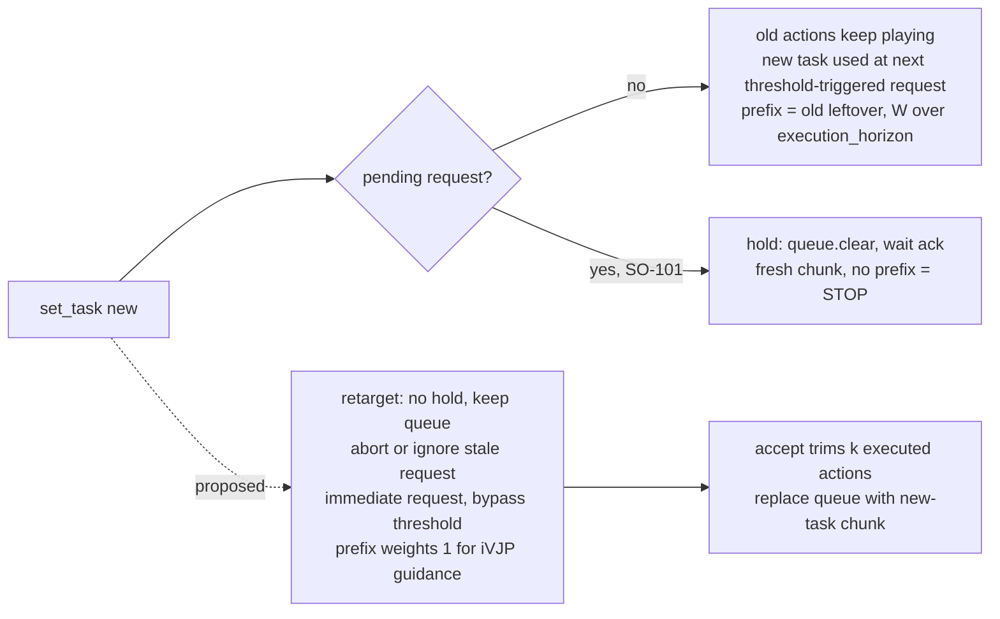

# Audit: RTC paper (arXiv 2506.07339) vs. huggingface/lerobot `main`, for prefix-guided instruction retargeting on SmolVLA / SO-101

**Date:** 2026-10-18 · **Slug:** `rtc-smolvla-lerobot` · **Plan:** `outputs/.plans/rtc-smolvla-lerobot.md`
**Paper:** Black, Galliker, Levine, *Real-Time Execution of Action Chunking Flow Policies* (NeurIPS 2025), arXiv 2506.07339v2. Read via alphaXiv full text.
**Code:** `huggingface/lerobot` `main` @ `146d8474932c8b566717eb2738ba459337ab71c4` (2026-10-16). Shallow clone in `outputs/.tmp-lerobot`, deleted after the audit. Reference implementation: `Physical-Intelligence/real-time-chunking-kinetix` `main`, `src/model.py` and `src/eval_flow.py`, read via raw.githubusercontent.
**Flags:** [V] = read in primary text or code this session (file:line given). [S] = secondary, e.g. a PR description I did not check against a diff. [U] = inference or estimate.
**Method note:** You told me not to spawn subagents, so the template's researcher/verifier passes were not run. Every line reference below comes from `cat -n`/`awk NR` output on the clone. No experiment was run because torch is not installed on this machine. The one numeric check was done by hand against the repo's own unit-test expected values (§1, M1).

---

## 0. Bottom line

1. **Yes, RTC runs for SmolVLA on LeRobot main** [V]. SmolVLA declares `supports_rtc() -> True` (`policies/smolvla/modeling_smolvla.py` L150–151). It routes `inference_delay`, `prev_chunk_left_over` and `execution_horizon` into the shared Euler integrator (L796–810). The local RTC engine (`inference/rtc.py`) and the remote Zenoh server (`remote_inference/server.py` L617–623) both drive it.
2. **The implementation is not faithful to the paper by default** [V]. There are three material mismatches:
   - **M1:** the guidance uses an *identity Jacobian* instead of the paper's vector-Jacobian product (VJP). `modeling_rtc.py` L217–218 evaluates the denoiser *before* `x_t.requires_grad_(True)`. Open PR #4945 confirms this and proposes an opt-in `"vjp"` mode.
   - **M2:** default β = 10, where the paper uses 5.
   - **M3:** the default schedule is LINEAR, where the paper uses EXP. The guided region is also capped at `execution_horizon=10` steps, where the paper uses H−s ≈ 25.
3. **The planned method is feasible, and much of the plumbing already exists** [V + U].
   - The engine already commits exactly the actions played during inference. `ChunkRuntime.accept` trims `min(measured, progress)` and replaces the queue (`inference/execution.py` L478, L499–506; `policies/rtc/action_queue.py` L296–299). So "keep k ≈ remaining inference steps" is the engine's native behaviour, not a new truncation.
   - The language embedding is recomputed on every chunk.
   - What is missing:
     - (a) a no-hold retarget path, because `set_task` forces a hold on SO-101 when a request is in flight;
     - (b) an immediate re-request on task change in RTC mode;
     - (c) a per-request guidance profile, so the old-task leftover is weighted only over the committed prefix;
     - (d) the VJP fix.
   - Estimated effort is about 1–2 weeks to a sim/bench-validated prototype [U].
4. **LeRobot's own instruction-change path is stop-based** [V]. The pull toward the old intent in RTC is **tunable in code**: the schedule, the horizon and β. That makes the old-intent bias a measurable ablation axis rather than a fixed property. This bias is the G2 core risk raised by πR².

---

## 1. Q1 — Is RTC implemented for SmolVLA, and does it match the paper?

### Paper reference values [V, 2506.07339 §3.1–3.3, Alg. 1, App. A.2, A.4, A.5]

- **Eq. 2:** $v_{\Pi GDM} = v + \min\!\big(\beta, \tfrac{1-\tau}{\tau r_\tau^2}\big)\,(Y-\hat A^1)^\top \mathrm{diag}(W)\,\tfrac{\partial \hat A^1}{\partial A^\tau}$. Here $\hat A^1 = A^\tau + (1-\tau)v$ and $r_\tau^2 = \tfrac{(1-\tau)^2}{\tau^2+(1-\tau)^2}$. The paper says the guidance term "is a vector-Jacobian product and can be computed using backpropagation", and Alg. 1 L28 computes it "via autodiff".
- **Eq. 5 (soft mask):** $W_i = 1$ for $i<d$. For $d\le i<H-s$, $W_i = c_i\frac{e^{c_i}-1}{e-1}$ with $c_i=\frac{H-s-i}{H-s-d+1}$. $W_i = 0$ for $i\ge H-s$.
- **Runtime delay:** $d = \max(Q)$ over a buffer of the last $b$ delays (Alg. 1 L17). The execution horizon is $s = \max(d, s_{min})$.
- **Real-world hyperparameters (Table 4):** n=5 denoising steps, H=50, s_min=25, β=5, b=10. β was ablated: there is "no marginal benefit beyond β = 5", and high β diverges with few steps (Fig. 7).
- **Schedules (Fig. 8):** exponential is best, linear is "very close behind". Diffuser-style overwrite inpainting "provides some benefit" but is outperformed by guidance.
- **Instruction:** never changed between chunks in the paper (consistent with G2 §1 item 2) [V].

### Code vs paper

| Item | Paper | LeRobot main (file:line) | Match? |
|---|---|---|---|
| Guidance form | ΠGDM VJP through denoiser (Eq. 2, Alg. 1 L26–28) | `x1_t = x_t - time*v_t`; `correction = autograd.grad(x1_t, x_t, err)`, but `v_t` is computed at L217 **before** `x_t.requires_grad_(True)` at L218 (`policies/rtc/modeling_rtc.py` L216–223) | **No (M1).** ∂x̂₁/∂x_t = I, so correction = err. The Kinetix reference uses `jax.vjp(denoiser, x_t)` (`src/model.py` `realtime_action`) [V] |
| Guidance weight | min(β, (1−τ)/(τ r²)) | `tau = 1 - time` (L170); `inv_r2 = ((1-τ)²+τ²)/(1-τ)²`; `c = (1-τ)/τ`; `min(c*inv_r2, β)` (L225–231) | Yes. The formula matches after LeRobot's NOISE_AT_ONE time flip, which `common/flow_matching.py` L280–285 documents |
| β default | 5 | `max_guidance_weight: float = 10.0` (`configuration_rtc.py` L75); docs call 10 "optimal" for 10-step flow (`docs/source/rtc.mdx` L123) | **No (M2)**, but this is a deliberate choice for n=10. The paper's Fig. 7 note (β ≥ 4.25 only affects the first step at n=5) does not transfer directly to n=10 [U] |
| Schedule default | Exponential | `prefix_attention_schedule = LINEAR` with comment `# Todo change to exp` (`configuration_rtc.py` L73–74). The docs example uses EXP and calls it "recommended" (`rtc.mdx` L53, L128) | **No (M3).** EXP is available (`modeling_rtc.py` L268–272), and the formula `w·expm1(w)/(e−1)` matches Eq. 5 |
| Soft-mask region | Weights 1 for i<d, decay over d…H−s−1, 0 from H−s | `get_prefix_weights(start=d, end=execution_horizon, total=H)` (L255–274). The linspace interior `(1,0, n+2)[1:-1]` (L284) equals $c_i$ when end = H−s | Formula matches. **Region differs (M4):** end = `execution_horizon` (default 10, `configuration_rtc.py` L76), further clamped to the prefix length (L194–195) |
| Prefix length supplied | All H−s leftover actions, right-padded to H with W=0 | `_prepare_continuation` slices the leftover to `model[:horizon]` and pads a short leftover by **repeating the last action** (`inference/prediction.py` L94–97). `RTCProcessor` then zero-pads to H (L201–204) | Partially. The repeat-pad gives padded rows a non-zero target. It only matters when the leftover is shorter than `execution_horizon` [V/U] |
| Terminology | s = execution horizon (actions executed per inference) | `execution_horizon` = length of the guided prefix region (paper's H−s); docs: "how many timesteps from the previous chunk to maintain consistency with" (`rtc.mdx` L115) | **Naming clash (M5)**, a reproduction trap |
| d estimation | max over last b=10 delays | `turnarounds: deque(maxlen=100)`; `turnaround = max(...)` (`inference/execution.py` L211, L221); `delay = ceil(turnaround/interval)` (L130) | Same idea, window 100 vs 10 (**M6**), so it is more conservative |
| Request trigger (s) | s = max(d, s_min), s_min=25 | Request when queued playback ≤ `max(queue_threshold/fps, turnaround+interval)`; `queue_threshold=30` (`inference/factory.py` L86; `execution.py` L224–226, L378–379) | Equivalent mechanism. With chunk 50 and threshold 30, s ≈ 20 at steady state [U, arithmetic] |
| Frozen first d actions | Guidance weight 1; the executed new chunk starts at index d | Merge discards the first `min(measured, progress)` actions of the new chunk (`execution.py` L470–478; `action_queue.py` L296–299) | Yes |
| d > guided region | Not possible (d ≤ H−s) | `start = min(start, end)` (`modeling_rtc.py` L256). If d > `execution_horizon`, rows from 10 to d−1 are unguided, and the first executed new action (index d) gets zero guidance | **Risk (M7):** need `execution_horizon ≥ d`. Nothing asserts this in guided mode [V code, U consequence] |
| Denoising steps | n=5 | SmolVLA `num_steps: int = 10` (`configuration_smolvla.py` L63) | Differs; it is the model default |
| Hard-prefix inference ("trained" RTC) | Not in this paper (it is in 2512.05964) | `mode="trained"` exists for PI0.5-compatible checkpoints only (`configuration_rtc.py` L68–70; `modeling_rtc.py` L45–50). Open PR #2830 "Implement training time rtc for pi0, pi0.5 and smolvla" [S] | Not available for SmolVLA |

**M1 numeric check (by hand, from the repo's own test)** [V]. `tests/policies/rtc/test_modeling_rtc.py::test_denoise_step_with_prev_chunk` uses the mock velocity v = 0.5·x with x = 1, time = 0.5, Y = 0.1, d = 5 and horizon 10.
- Guidance weight: (1−τ)/τ · 1/r² = 1·2 = 2.
- With J = I: x̂₁ = 0.75, err = −0.65, result = 0.5 + 2·0.65 = **1.80**. This is the test's asserted value.
- With the true Jacobian (∂x̂₁/∂x = 1 − 0.5·0.5 = 0.75): result = 0.5 + 2·0.4875 = 1.475.

So the test suite pins the identity-Jacobian behaviour. The docs still describe it as "the original Jacobian guidance" (`rtc.mdx` L97; `configuration_rtc.py` L68).

**Consequence of M1 for our method** [U, reasoning from code + PR #4945 text]:
- With J = I, guidance modifies only rows where W > 0, and in our design those are the committed rows, which the merge discards anyway.
- Future rows are pulled toward the prefix only *indirectly*: the modified prefix rows feed the next denoising step through attention. This is closer to Diffuser-style replacement, which the paper's Fig. 8 shows is weaker.
- So with a hard committed-prefix mask (W = 1 for i < k, 0 after), the identity Jacobian may give very weak seam continuity. **The VJP fix matters more for our design than for default RTC.**

---

## 2. Q2 — Action queue: location, truncation/merge, task injection, `set_task` semantics

### Where the queue lives [V]

- `policies/rtc/action_queue.py`: `ActionQueue` holds processed `queue` and model-space `original_queue`, plus per-action `_task_queue` labels and provenance (L82–90).
- It is instantiated by `ChunkRuntime` with `RTCConfig(enabled = mode is not CHUNK)` (`inference/execution.py` L202).
- The legacy `src/lerobot/async_inference/` (PolicyServer/RobotClient, `aggregate_fn`) **does not exist on main** (`ls` fails). Its replacements are `lerobot.inference` (sync / rtc) and `lerobot.remote_inference` (Zenoh client/server). This matches the G2 report.

### Truncation and merge [V]

- **RTC mode** (`merge` → `_replace_actions_queue`, L268–271, L296–299): the queue is **replaced** by `new_chunk[delay:]`. Here `delay = min(real_delay, cursor − snapshot.cursor)` (L264), i.e. the actions actually consumed while inference ran, and `real_delay = ceil(elapsed/interval)` (`execution.py` L471, L499–506). The old leftover beyond that point is dropped. This is the paper's "swap as soon as available".
- **Chunk/append mode** (L273–276, L321–337): new actions are appended after the remaining old ones.
- **Leftover for guidance:** `get_left_over()` / `snapshot().model_actions = original_queue[last_index:]` (L129–141, L209–222). It is captured at `begin()` (`execution.py` L394, L417–426) and passed as `model_continuation` → `prev_chunk_left_over` (`inference/rtc.py` L584–613; `prediction.py` L126–144).
- **`replace_future(...)`** (L154–176) can swap the uncommitted future atomically, guarded by `generation` and `cursor`. It is a ready-made primitive for mid-queue replacement.

### Can a new task be injected mid-queue without invalidating it?

Partly. It depends on timing [V]:
- **Between requests** (no `pending`): `set_task` bumps `_task_version` and does **not** hold (`inference/rtc.py` L308–335; `needs_hold` requires `pending is not None`, L323–329). The old actions keep playing, and each action keeps its own task label (`action_queue.py` L64–65).
  - The next request uses the new task (L572–576, L598) with the **old-task leftover as the RTC prefix** (L584–586).
  - But the request only fires when playback drops to the threshold. The task-change bypass of that threshold exists **only for `chunk_merge == "aligned"`**, i.e. plain chunk mode (`execution.py` L363–369; `factory.py` L151–155 forbids aligned with RTC).
  - So in RTC mode the switch takes effect after up to (queue − threshold) actions plus one inference latency [U arithmetic].
  - Docs: "A change between requests can retain already accepted actions for continuity" (`docs/source/inference.mdx` L419).
- **During a request** (`pending` exists) on a robot with `supports_hold`: `_request_hold("Instruction change")` (`rtc.py` L332–333) calls `runtime.invalidate(held=True)`, which does `queue.clear()` and bumps `generation` (`rtc.py` L406–416; `execution.py` L242–263).
  - The RTC loop then waits for the control thread's hold acknowledgement (`rtc.py` L531–534), drops queued actions (L553), and releases the hold (L558–560).
  - The next chunk has an **empty continuation**, so no RTC prefix applies (`prediction.py` L77–78 returns `None`).
  - Any stale in-flight result is rejected by the generation check and the `task_version` check (`execution.py` L434–438).
- **SO-101 takes the hold path:** `SOFollower.supports_position_hold = True` (`robots/so_follower/so_follower.py` L62). The RTC engine calls `configure_position_hold()` when the robot supports it (`rtc.py` L180–181), which makes `supports_hold` true (`rollout/robot_wrapper.py` L97–109).
- **Without hold:** the stale result is discarded and the robot "can exhaust its remaining actions and terminate" (`inference.mdx` L419; `rtc.py` L311–312).
- **Remote engine:** same policy. `if self.runtime.pending is not None: self._request_hold("instruction change")` (`remote_inference/engine.py` L421–443).
- **Sync engine:** drops precomputed actions (`inference.mdx` L419; `PreTrainedPolicy.drop_queued_actions`, `policies/pretrained.py` L244–250).

**What exactly `set_task` does.** In the base class it sets `_task`, `_task_changed` and `_task_version++`, and nothing else (`inference/base.py` L210–222). In the RTC and remote engines it adds: **hold** (only if a request is in flight and the robot supports hold), **discard** (queue cleared on hold; stale results always rejected), and **wait for ack** (`HoldState.acknowledge` via the control loop, `rtc.py` L394–401, L531–534). Docs: "Expect a stop during this transition; it is not a guaranteed continuous blend" (`inference.mdx` L419). The library API is `RolloutController.set_task` (`rollout/controller.py` L281–293) and the CLI is `/subtask` (`rollout/interactive.py` L139).

---

## 3. Q3 — Is the language embedding recomputed per chunk?

**Yes** [V].
- `batch["task"] = [task]` is set on every RTC request (`inference/rtc.py` L598).
- The SmolVLA preprocessor tokenizes it on every call (`NewLineTaskProcessorStep` + `TokenizerProcessorStep`, `policies/smolvla/processor_smolvla.py` L68–73; task read from the transition, `processor/tokenizer_processor.py` L120). I found no tokenizer cache (grep for `cache|lru` is empty).
- `sample_actions` re-embeds the prefix (`embed_prefix`, which includes `embed_language_tokens`; `modeling_smolvla.py` L781–783, L647) and builds a fresh KV cache with `past_key_values=None` (L787–793). The per-step `crop(prefix_len)` (L840–842) only restores the cache *within* one chunk.

So a changed instruction takes effect on the **next chunk** with no stale-cache issue. Unlike Reflex (2607.14695), LeRobot does not pin the instruction. One caveat is that with `--use_torch_compile=true` a new token length can trigger recompilation and a possible fault (`inference.mdx` L421) [V].

---

## 4. Q4 — Hooks needed and effort

The target behaviour: on a spoken change, commit the k ≈ d actions that will play during inference, re-denoise immediately under the new task with guidance on only that committed prefix, and do not hold or retract.

| # | Hook | File / function | What to change | Size [U] |
|---|---|---|---|---|
| H1 | No-hold retarget mode | `inference/rtc.py::RTCInferenceEngine.set_task` (L308–335); remote twin `remote_inference/engine.py::set_task` (L421–443) | Add `retarget="hold"\|"rtc_prefix"`. In `rtc_prefix`, skip `_request_hold`, keep the queue, mark the pending request stale | S |
| H2 | Immediate re-request in RTC mode | `inference/execution.py::ChunkRuntime.should_request` (L352–379) and `begin` (L381–427) | Extend the existing aligned-mode task-version bypass (L363–369) to `RTC_GUIDED`, so a task change triggers a request regardless of the playback threshold | S |
| H3 | Don't wait for the stale in-flight call | `inference/rtc.py::_rtc_loop` (L584–616); `common/flow_matching.py::euler_integrate` (L256+) | The loop is single-threaded: an old-task `predict_chunk` blocks until done (≤ 1 latency wasted) and is then rejected (`execution.py` L437). Option A: accept that cost (simplest; measure it). Option B: check `task_version` between Euler steps and abort early | A: 0 · B: M |
| H4 | Per-request guidance profile | `inference/prediction.py::predict_chunk` / `_prepare_continuation` (L67–144); `policies/rtc/modeling_rtc.py::denoise_step` / `get_prefix_weights` (L122–274); SmolVLA passthrough already exists (`RTCActionSelectKwargs.execution_horizon`, `pretrained.py` L63–68; `modeling_smolvla.py` L807–809) | `predict_chunk` currently passes only `inference_delay` and `prev_chunk_left_over` (L144). Add `execution_horizon` and a schedule/β override. Retarget requests use `ZEROS` (W = 1 for i < k) or a short decay, plus a β sweep. Ordinary requests keep the defaults. Assert `execution_horizon ≥ d` (M7) | S–M |
| H5 | True VJP guidance | `policies/rtc/modeling_rtc.py` L216–223 | Cherry-pick or replicate open PR #4945 (`guidance_jacobian="vjp"`). Costs one backward pass through the action expert per denoising step: latency rises, which raises d. **Must be measured on our GPU** | S code, M validation |
| H6 | Speech front-end → `set_task` | Our code, calling `RolloutController.set_task` (`rollout/controller.py` L281) | Streaming ASR + parse → `set_task`. LeRobot has only stdin `/subtask` | M (ours, outside LeRobot) |
| H7 | Logging for metrics | `ActionQueue` provenance/task labels (`action_queue.py` L64–65, L107–127); `runtime.last_accept` (`execution.py` L491–495) | Log onset time, `task_version`, trimmed k, and per-action task label alongside joint traces. Needed for onset→motion-change latency and jerk | S |

**Effort estimate** [U]:
- H1+H2+H4+H7 with option H3-A: roughly 200–400 LOC plus unit tests in the existing `tests/policies/rtc/` and `tests/` style. That is about **3–5 developer-days**.
- Adding H5 and its latency validation: **+2–4 days**.
- Bench validation on SO-101 (supervised, boundaries rule 1) is separate.
- Maintaining a fork against a fast-moving `main` (`inference/` and `remote_inference/` were rewritten around Aug–Oct 2026, per PRs #4380/#4836/#4937 [S]) is a real recurring cost. Keep the changes behind config flags and the patch small.

**Baselines map directly onto existing knobs** [V/U]:
- B1 hold-and-refresh = current `set_task` on SO-101.
- B2 bare switch = current between-request path.
- B3 truncate + fresh chunk without RTC = H1+H2 with `rtc.enabled=false`, or with an empty prefix.
- Prefix-bias ablation = schedule {ZEROS, LINEAR, EXP} × horizon {k, 10, 25} × β {5, 10} × Jacobian {identity, vjp}.

---

## 5. Q5 — Does ACT support any of this?

**No language input and no RTC** [V].
- `policies/act/modeling_act.py` has no language/task tokens: the only "lang" hit is the license header (L14).
- ACT does not override `supports_rtc()`, so it inherits `False` from `policies/pretrained.py` L279–281. `supports_rtc_inference` therefore rejects it (`inference/rtc.py` L84–98).
- Temporal ensembling (`modeling_act.py` L70–71, L113–115) is rejected by chunk inference (`policies/pretrained.py` L333–334).
- ACT can run asynchronously only in plain `chunk` mode with `aligned` merge and optional `blend_steps` (`execution.py` L169–186; `factory.py` L120–123).
- So for ACT an "instruction change" can only mean swapping checkpoints. It stays a motion-quality / blending baseline (B8), as G2 §6 already says.

---

## 6. Q6 — Known issues and PRs (GitHub search API, 4 narrow queries, 2026-10-18)

| # | State | Relevance | Flag |
|---|---|---|---|
| **#4945** `fix(rtc): backpropagate through the denoiser in RTC guidance` (2026-10-13) | open | Confirms M1 independently. Adds `RTCConfig.guidance_jacobian ∈ {identity (default), vjp}`, masks padded action dims in vjp mode, keeps the default unchanged. Reports ‖J_FP‖/‖J_PP‖ = 1.60 / 0.63 / 0.25 at t = 0.9 / 0.5 / 0.1 on a Gaussian fit to `lerobot/pusht` (author's numbers, not reproduced) | [V] PR body; diff not read [S] |
| **#4108** `feat(rollout): online task switching for language-conditioned policies` (2026-07-22) | open | Voice/STT → stdin task switching; motivation explicitly mentions voice commands. Uses a **deferred flush** of the action queue (`flush_action_queue`), i.e. discard, not prefix-preserving. Predates and partly overlaps the merged `set_task`/`/subtask` (PR #4380 [S]). Closest community prior art to "spoken mid-run switch on LeRobot"; it is a stop/flush design, so it is a baseline, not the wedge | [V] PR body [S] diff |
| #2830 `Implement training time rtc for pi0, pi0.5 and smolvla` (2026-01-20) | open | Would give SmolVLA hard-prefix trained RTC, an alternative to guided RTC for our method | [S] title only |
| #3125 `Remote rtc` (2026-03-10) | open | Older remote-RTC attempt, likely superseded by `remote_inference` | [S] title only |
| #4717 / #4718 `Fix/rtc chunking seams 2/3` (2026-09-22) | closed, not merged | Seam fixes; PR body is an empty template | [V] body empty |
| #4394 `feat(multi_task_dit): add RTC inference support` | open | Not relevant to SmolVLA | [S] |
| `remote_inference/README.md` L365, L399 | in repo | Design table: "Immediate planned language wait — discards continuation and can disrupt task progress"; follow-up "Buffered motion during informational VQA" is a *priority*. That signals HF intent to reduce hold-induced discontinuity, which is a scoop risk for the infrastructure side | [V] |

**No issue or PR found that combines RTC prefix guidance with an instruction change.** This is a negative result from four narrow queries (`rtc task`, `rtc instruction`, `set_task`, `rtc jacobian`). It is not exhaustive: I did not read comments or PR diffs, and I did not search Discussions or Discord.

---

## 7. Mismatches, ambiguous defaults, reproduction risks (consolidated)

1. **M1, identity Jacobian** [V]: the docs and comments claim "original Jacobian guidance" but the code does not compute it. Any result labelled "RTC" on LeRobot ≤ 146d847 is RTC-with-J=I. Report which variant is used.
2. **M2, β = 10 vs 5** [V]. **M3, LINEAR default vs EXP** [V]. The config has a TODO, and the docs recommend EXP while the default is LINEAR.
3. **M4/M5, `execution_horizon` means the guided-region length (default 10), not the paper's s** [V]. The paper's real setup corresponds to about 25.
4. **M6, delay window max over 100 vs 10** [V]. A single slow call (e.g. a recompile) inflates d for the next 100 requests [U].
5. **M7, d > `execution_horizon` leaves the first executed action unguided** [V code / U effect]. This matters on SO-101 if latency spikes.
6. **Repeat-last padding** of short leftovers gives non-zero targets beyond the real prefix [V].
7. **n = 10 denoising steps** (SmolVLA) vs 5 in the paper: guidance-weight clipping behaves differently, so the β ablation must be redone [U].
8. **Task-change latency in RTC mode** is bounded by the playback threshold (no bypass outside aligned/chunk mode) [V]. Any B2 "bare switch" number depends on `queue_threshold`, which must be reported.
9. **Fast-moving code:** the async stack was rewritten in 2026. Pin the commit hash in the paper.
10. The **G2 claim "set_task is stop-based"** holds only for an *in-flight* change on a hold-capable robot. A between-request change does not stop, so B1 vs B2 differ by timing alone. The benchmark should control or log when the utterance lands relative to the request cycle [V/U].

## 8. Blocked / not done

- **No experiment run:** torch is not installed here, so the M1 check is analytic, from test expected values. `TODO: run experiment`: instantiate `RTCProcessor` on a real SmolVLA checkpoint, compare identity vs vjp corrections on future rows, and measure added latency.
- **Not done:** I did not read PR diffs (#4945, #4108, #2830) or their review comments. I did not read the Kinetix `get_prefix_weights` call site for the real-robot (π0.5) code, which is not public; only the sim code is.
- **Not searched:** GitHub Discussions and the HF Discord. The search was limited by your no-broad-web instruction.
- **Subagents:** not used, per your instruction. The template's researcher/verifier passes were replaced by direct reading and grep with line numbers.
- **Repo files:** you limited edits to `outputs/`, so `07-iteration-log.md`, `05-gap-analysis.md` and `09-session-handover.md` were **not updated**. Suggested entry: "G2 wedge feasible on LeRobot main @146d847; 4 hooks; RTC J=I caveat (PR #4945)."
- No robots.txt, paywall or login blocks were encountered.

## 9. Next steps

1. Pin the commit. Prototype H1+H2+H4 behind a flag on a local branch, and cherry-pick #4945 for H5.
2. Offline check before hardware: replay recorded SO-101 observations, force a task switch at fixed cursor positions, and log the seam jerk of the new chunk vs the committed prefix across the ablation grid in §4.
3. Measure SmolVLA turnaround with and without VJP on the target GPU, and set `execution_horizon ≥ d_max`.
4. Run a supervised bench test of B1 vs B2 vs B3 vs ours on SO-101, and verify the hold behaviour claimed in §2 (G2 open item).
5. Watch PRs #4945, #4108 and #2830 and the README "Buffered motion" item weekly for scoop or merge.

## Sources

- RTC paper: Black, Galliker, Levine, *Real-Time Execution of Action Chunking Flow Policies*, 2025. https://arxiv.org/abs/2506.07339 · https://www.alphaxiv.org/abs/2506.07339
- RTC sim reference code: https://github.com/Physical-Intelligence/real-time-chunking-kinetix (`src/model.py`, `src/eval_flow.py`; raw: https://raw.githubusercontent.com/Physical-Intelligence/real-time-chunking-kinetix/main/src/model.py)
- LeRobot repository: https://github.com/huggingface/lerobot (commit https://github.com/huggingface/lerobot/tree/146d8474932c8b566717eb2738ba459337ab71c4)
  - `src/lerobot/policies/rtc/{configuration_rtc.py, modeling_rtc.py, action_queue.py}`
  - `src/lerobot/policies/smolvla/{modeling_smolvla.py, configuration_smolvla.py, processor_smolvla.py}`
  - `src/lerobot/policies/common/flow_matching.py`, `src/lerobot/policies/pretrained.py`, `src/lerobot/policies/act/modeling_act.py`
  - `src/lerobot/inference/{rtc.py, execution.py, prediction.py, base.py, factory.py}`
  - `src/lerobot/remote_inference/{engine.py, server.py, README.md}`
  - `src/lerobot/rollout/{controller.py, interactive.py, robot_wrapper.py}`, `src/lerobot/robots/so_follower/so_follower.py`
  - `docs/source/{inference.mdx, rtc.mdx, remote_inference.mdx}`, `tests/policies/rtc/test_modeling_rtc.py`
- LeRobot PR #4945: https://github.com/huggingface/lerobot/pull/4945
- LeRobot PR #4108: https://github.com/huggingface/lerobot/pull/4108
- LeRobot PR #2830: https://github.com/huggingface/lerobot/pull/2830
- LeRobot PR #3125: https://github.com/huggingface/lerobot/pull/3125
- LeRobot PRs #4717/#4718: https://github.com/huggingface/lerobot/pull/4717 · https://github.com/huggingface/lerobot/pull/4718
- Training-time RTC (context for the `trained` mode): https://arxiv.org/abs/2512.05964
- Context: `outputs/g2-midmotion-repair-novelty.md`, `10-research-map-and-implementation.md`
